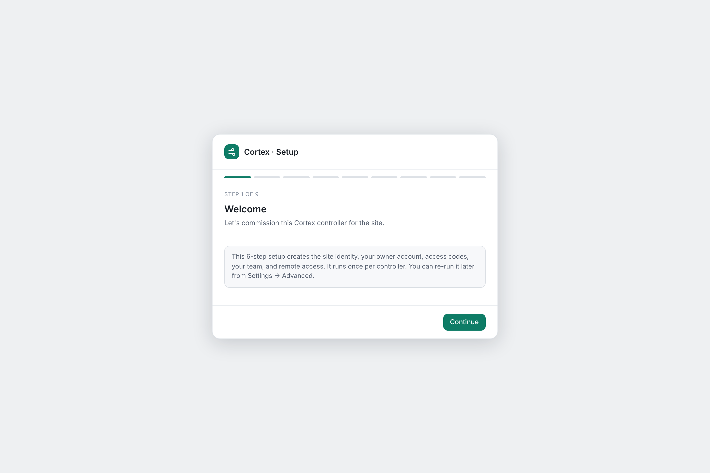
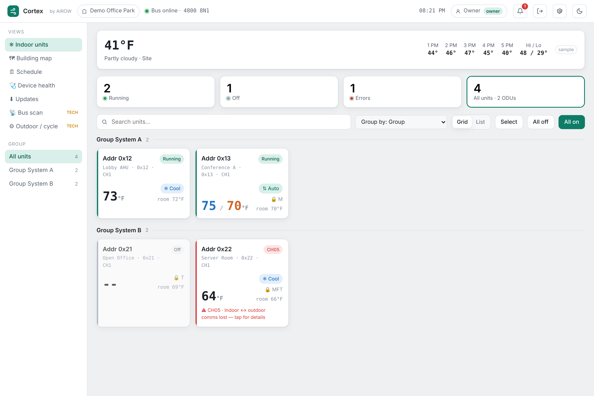
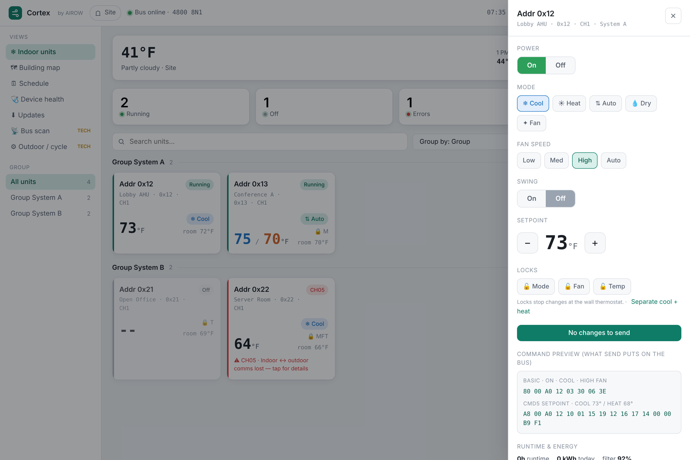
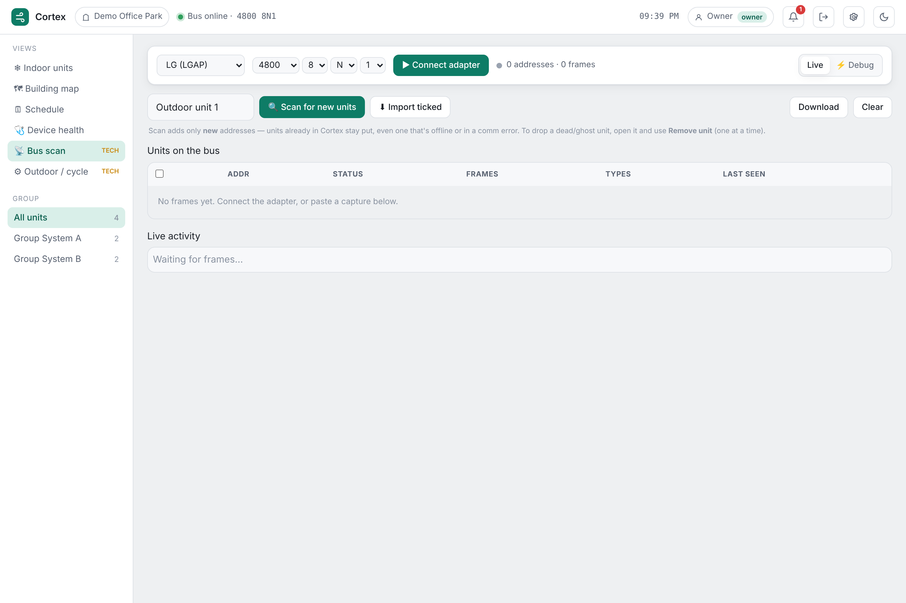
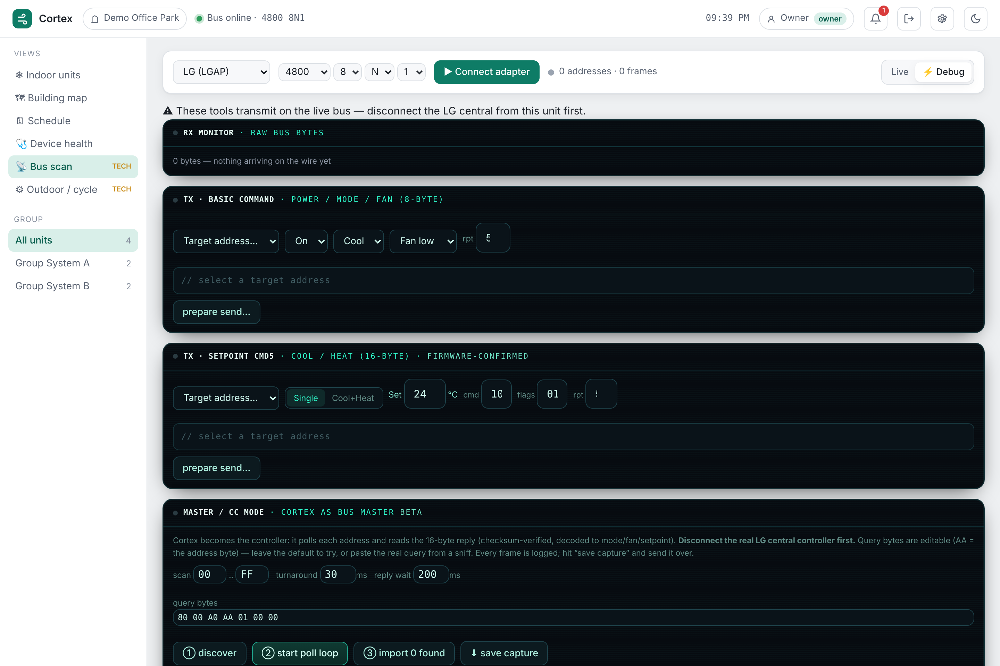
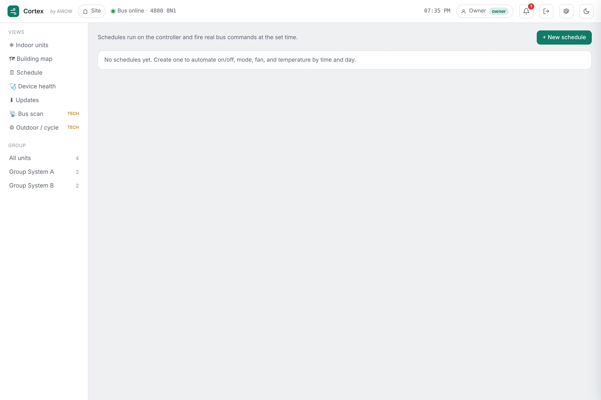

# Cortex — a self-hosted replacement for LG central HVAC controllers

Cortex replaces LG's ACP / AC Smart central controllers. It speaks the LG **LGAP** protocol
directly over the RS485 bus, so a small mini-PC on-site runs the whole indoor-unit fleet —
power, mode, fan, dual setpoints, locks — from a clean web UI you reach on the LAN or
remotely over Tailscale. No cloud, no per-controller license, no vendor lock-in.

> **Status:** working appliance + UI. The LGAP **master/controller** mode has been
> **field-validated on a live Multi V IV system** — Cortex discovered 14 indoor units, decoded
> their state, and controls them directly. Still verifying a couple of details (the ODU/system
> grouping byte and error-code propagation). Reverse-engineering notes are in
> **[LGAP_reference.md](LGAP_reference.md)**; see **[CHANGELOG.md](CHANGELOG.md)** for release
> history. Contributions welcome.

---

## What it looks like

**First-run setup wizard** — name the site, pick the RS485 adapter. Runs once; after that
everyone gets a login screen.



**Dashboard** — every indoor unit at a glance: what it's set to, the room temperature, mode,
locks and faults, in your own groups. This is the screen a customer uses day to day, so it shows
names — never bus addresses. (Screenshots below predate the v1.5.0 tile and logo refresh.)



**Unit control** — tap a unit for power, mode, fan, dual cool/heat setpoints, and per-function
locks.



**Bus scan (live)** — a readable, real-time view of what's happening on the RS485 bus.



**Master / CC mode + debug tools** — the byte-level workshop: Cortex drives the bus like the
LG controller (discover units, poll replies, send commands), with raw TX/RX logging.



**Settings / About** — remote access, power controls, and the full LGAP protocol reference
built right into the app.



---

## Features
- **Direct LGAP control** — power, mode, fan, and setpoint over RS485 (no ACP/AC Smart needed).
- **Master / CC mode** — Cortex drives the bus like the LG controller: one-tap guided setup,
  auto-discovery of indoor units, continuous polling, and background re-discovery that offers to
  add units that appear later (e.g. after a remodel).
- **Your own layout** — organize units into a 2-level group → subgroup tree (e.g. *Main
  building → 3rd floor*), rename and move units, independent of the physical outdoor-unit wiring.
- **Built for three audiences** — customers see names, temperatures and a plain **Send** button
  (and can rename a unit with one tap); bus addresses, channels, raw frames and the command
  preview appear only for technicians, inside the unit's control panel.
- **Building map with floor plans** — every unit drawn top-down and animated with its live state;
  a technician/admin can upload a floor-plan picture per group and drag units onto it (snap to
  grid, explicit *Edit layout* mode), shared by every browser.
- **Schedules** — on/off, mode, fan, and setpoint by time and day, with **nth-weekday**
  recurrence (e.g. the 4th Thursday) and **weather conditions** (e.g. *outdoor below 30 → heat
  at 74*).
- **Live local weather** — real conditions for the site, used by the dashboard and schedules.
- **Device health** — real CPU, memory, disk, temperature, uptime, and bus activity read from
  the appliance OS, one tap from the header (technicians and admins).
- **Optional HTTPS** — opt-in secure access alongside plain http, with a self-signed certificate
  out of the box or a trusted one from Tailscale
  ([how to enable](appliance/README-appliance.md)).
- **Accounts & sessions** — per-site logins and roles (customer / admin / technician / owner),
  persistent sessions with an admin-set idle auto-logout.
- **Built-in protocol reference**, backup/restore, setpoint limits, per-site settings, and
  over-the-air updates.

---

## Install it yourself

You need a small always-on PC (a cheap N95/N100 mini-PC is ideal), a **USB-to-RS485 adapter**
(e.g. a Waveshare), and about 20 minutes.

### 1. Put Linux on the mini-PC
1. Download **Ubuntu Server 24.04 LTS** (or Debian 12).
2. Flash it to a USB stick with [balenaEtcher](https://etcher.balena.io/) or Rufus.
3. Boot the mini-PC from the stick and install. When asked, create your login and **tick
   “Install OpenSSH server”** so you can reach it from your laptop.

### 2. Find it on the network
After it reboots, from your laptop:
```
ssh <your-login>@<mini-pc-ip>
```
(Your router's device list shows the IP.) If the wired port didn't get an address, set it to
DHCP: `sudo nano /etc/netplan/01-cortex.yaml` →
```
network:
  version: 2
  ethernets:
    enp2s0:            # your adapter name from `ip a`
      dhcp4: true
```
then `sudo netplan apply`.

### 3. One command installs everything
```
curl -fsSL https://raw.githubusercontent.com/h2erft/cortex/main/appliance/bootstrap.sh | sudo bash
```
That pulls this repo and runs the installer — Node, the Cortex service, a firewall, Tailscale,
`cortex.local` on the network, and automatic over-the-air updates. (~10 minutes.)

### 4. Open it
From any phone or laptop on the same network:
```
http://cortex.local:8080
```
The setup wizard walks you through naming the site and picking the adapter. For remote access,
run `sudo tailscale up` on the box and reach it at its Tailscale IP from anywhere.

Full details, the OTA release flow, and troubleshooting are in
**[appliance/README-appliance.md](appliance/README-appliance.md)**.

---

## How it works
- **`cortex.html`** — the controller UI (served by the appliance, or openable as a file for a demo).
- **`command-center.html`** — the fleet console: all your sites in one place with live health.
- **`appliance/`** — the mini-PC backend (serial bridge, systemd service, installer, OTA).
- **`LGAP_reference.md`** — the decoded LGAP protocol: bus, framing, checksums, command and
  reply layouts, mode/fan codes, and the open questions.

## Contributing
This is interoperability work on equipment we own. The most useful contributions right now are
**real LGAP bus captures** (especially an ACP discovering + polling indoor units) and anything
you know about the LGAP reply layout. See [LGAP_reference.md](LGAP_reference.md).

## Releases / OTA
Tag a version and push it — a GitHub Action builds the release, and every deployed appliance
pulls it automatically (verified, with auto-rollback):
```
git tag vX.Y.Z && git push origin vX.Y.Z
```
Pre-releases follow `vX.Y.Z-beta.N` (early field testing) → `vX.Y.Z-rc.N` (feature-frozen,
final shakeout) → `vX.Y.Z` (stable). Mark the GitHub release as a **pre-release** for the
beta/rc tags.

*Cortex by AIROW. Not affiliated with or endorsed by LG.*
